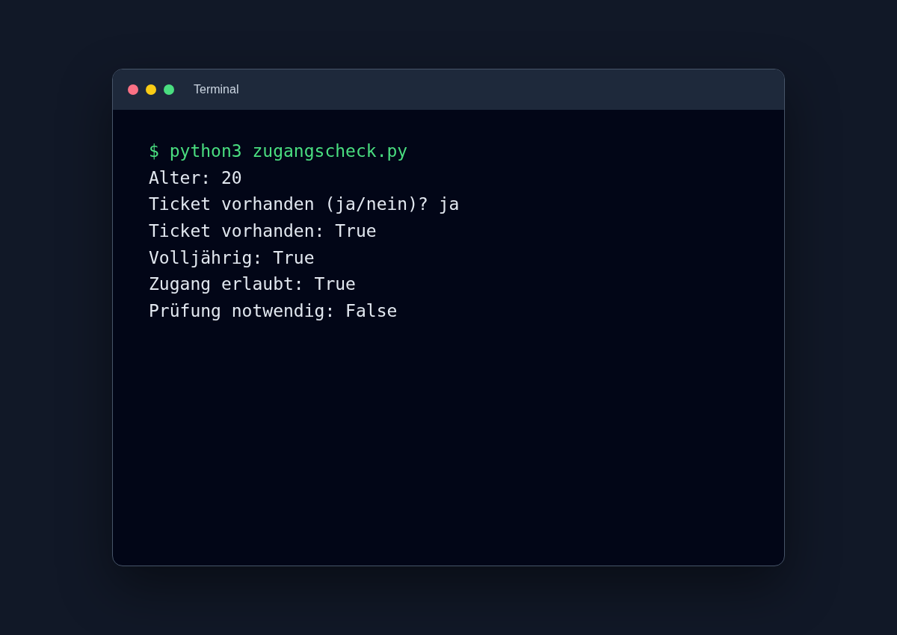

# Zugangscheck

## Dein Ziel

Prüfe Alter und Ticket mit Boolean-Werten:



## Beispiel zum Prinzip

```python
is_open = True
has_time = False

can_visit = is_open and has_time
needs_new_plan = not can_visit
```

`not` kehrt einen Wahrheitswert um: Aus `True` wird `False` und umgekehrt.

## Arbeitsauftrag

Erstelle `zugangscheck.py` und frage Alter sowie `ja` oder `nein` für das Ticket ab.

- Bereinige die Ticketantwort mit `.strip().lower()`.
- `has_ticket` ist wahr, wenn die bereinigte Antwort genau `ja` ist.
- `is_adult` ist wahr, wenn die Person mindestens 18 Jahre alt ist.
- `can_enter` ist nur wahr, wenn die Person volljährig ist und ein Ticket hat.
- `needs_check` ist wahr, wenn die Person minderjährig ist oder kein Ticket hat.
- Gib jeden Wert mit einer Beschriftung aus.

Du brauchst dafür kein `if`.

## Fertig, wenn

- die Ergebnisse als `True` oder `False` erscheinen
- die vier Werte genau die beschriebenen Prüfungen darstellen
