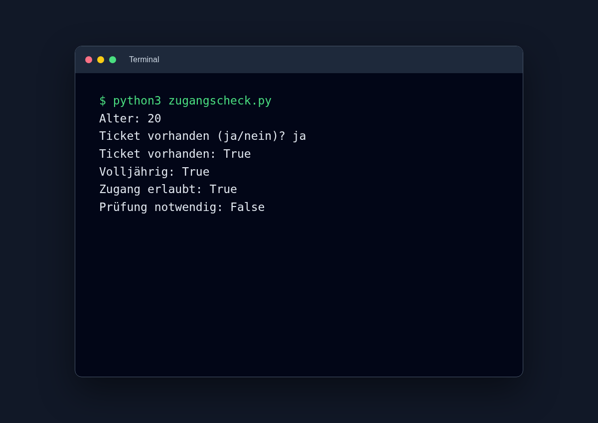

# Access Check

## Your goal

Check age and ticket using Boolean values:



## Example of the principle

```python
is_open = True
has_time = False

can_visit = is_open and has_time
needs_new_plan = not can_visit
```

`not` reverses a Boolean value: `True` becomes `False` and vice versa.

## Task

Create `zugangscheck.py` and ask for an age and `ja` or `nein` for the ticket, as shown in the screenshot.

- Clean the ticket answer using `.strip().lower()`.
- `has_ticket` is true when the cleaned answer is exactly `ja`.
- `is_adult` is true when the person is at least 18 years old.
- `can_enter` is true only when the person is an adult and has a ticket.
- `needs_check` is true when the person is under 18 or has no ticket.
- Print each value with a label.

You do not need an `if` statement.

## Done when

- the results appear as `True` or `False`
- the four values represent exactly the described checks
