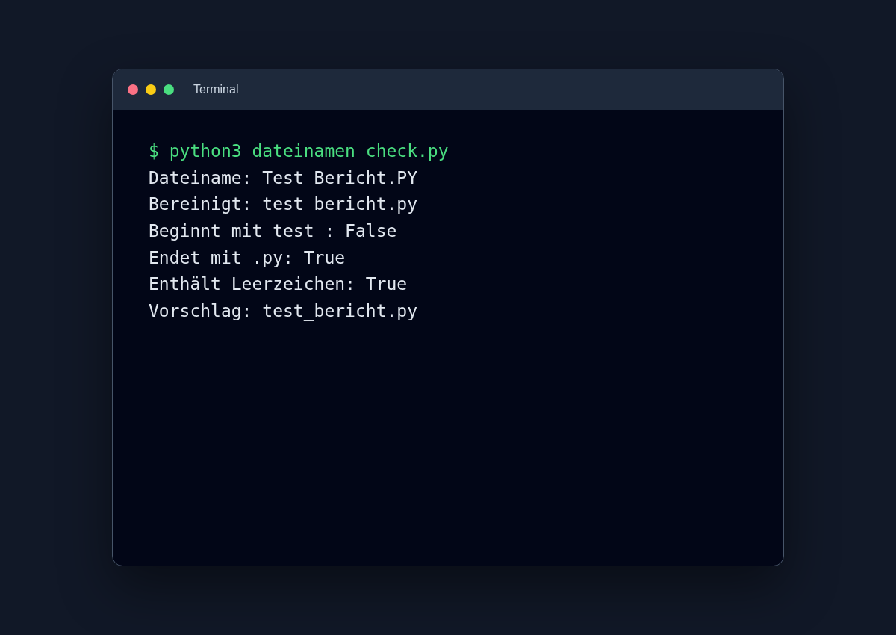

# Dateinamen-Check

## Dein Ziel

Untersuche und verbessere einen eingegebenen Dateinamen. Entscheide anschließend mit `if/else`, ob der bereinigte Name alle Regeln erfüllt.

Das Bild zeigt die Prüfungen und den Namensvorschlag. Die abschließende Meldung ergänzt du selbst:



## Beispiele zum Prinzip

```python
"photo.jpg".startswith("photo")
"photo.jpg".endswith(".jpg")
" " in "my photo.jpg"
"my photo.jpg".replace(" ", "_")
```

Die ersten drei Ausdrücke liefern `True` oder `False`.

## Arbeitsauftrag

Erstelle `dateinamen_check.py`. Frage einen Dateinamen ab und:

- entferne Leerzeichen am Rand
- wandle ihn in Kleinbuchstaben um
- prüfe, ob der bereinigte Name mit `test_` beginnt
- prüfe, ob er mit `.py` endet
- prüfe, ob er noch Leerzeichen enthält
- erzeuge einen Vorschlag mit Unterstrichen statt Leerzeichen

Gib alle Ergebnisse beschriftet aus.

### Mit `if/else` entscheiden

Prüfe nun, ob der bereinigte Name alle drei Regeln gleichzeitig erfüllt:

- Er beginnt mit `test_`.
- Er endet mit `.py`.
- Er enthält keine Leerzeichen.

Gib mit `if/else` entweder `Der Dateiname passt.` oder `Bitte überarbeite den Dateinamen.` aus.

Entscheide anhand des bereinigten Namens, bevor Leerzeichen durch Unterstriche ersetzt werden. Der Vorschlag wird zusätzlich ausgegeben und verändert diese Entscheidung nicht.

## Hilfe

- Verbinde die Regeln mit `and`.
- Die Prüfung auf enthaltene Leerzeichen muss für einen passenden Namen falsch sein. Mit `not` kannst du einen Boolean umkehren.

## Fertig, wenn

- `Test Bericht.PY` zum Vorschlag `test_bericht.py` wird
- alle drei Prüfungen als Boolean sichtbar sind
- genau eine passende Meldung durch `if/else` ausgegeben wird
- `  Test_Bericht.PY  ` nach dem Bereinigen akzeptiert wird
- ein fehlendes `test_`, eine andere Endung oder ein Leerzeichen im bereinigten Namen zur Aufforderung zum Überarbeiten führt
