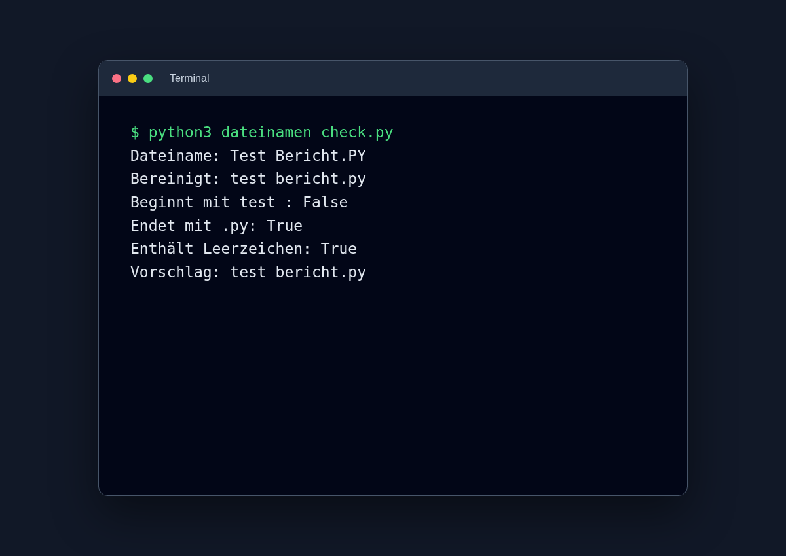

# Filename Check

## Your goal

Inspect and improve an entered filename. Then use `if/else` to decide whether the cleaned name meets all the rules.

The image shows the checks and the suggested name. You will add the final message yourself:



## Examples of the principle

```python
"photo.jpg".startswith("photo")
"photo.jpg".endswith(".jpg")
" " in "my photo.jpg"
"my photo.jpg".replace(" ", "_")
```

The first three expressions return `True` or `False`.

## Task

Create `dateinamen_check.py`. Ask for a filename and:

- remove spaces at the edges
- convert it to lower case
- check whether the cleaned name starts with `test_`
- check whether it ends with `.py`
- check whether it still contains spaces
- create a suggestion using underscores instead of spaces

Print all results with labels.

### Make a decision with `if/else`

Now check whether the cleaned name meets all three rules at the same time:

- It starts with `test_`.
- It ends with `.py`.
- It contains no spaces.

Use `if/else` to print either `Der Dateiname passt.` (the filename meets the rules) or `Bitte überarbeite den Dateinamen.` (please revise the filename).

Base the decision on the cleaned name before spaces are replaced with underscores. Print the suggestion as additional information; it does not change this decision.

## Help

- Connect the rules using `and`.
- The check for spaces must be false for a name to meet the rules. You can use `not` to reverse a Boolean value.

## Done when

- `Test Report.PY` becomes the suggestion `test_report.py`
- all three checks are visible as Boolean values
- exactly one appropriate message is printed using `if/else`
- `  Test_Report.PY  ` is accepted after cleaning
- a missing `test_`, a different extension, or a space in the cleaned name results in the request to revise it
